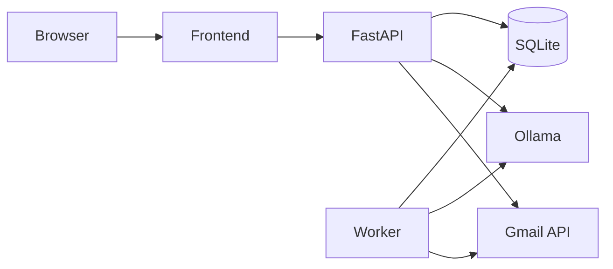

# SalesPilot AI

Local sales desk for leads, Gmail, and a tool-using agent. The model runs in Ollama on your machine. Business data is stored in SQLite. Background polling runs in a worker process, not in the browser.



| Service | URL |
| --- | --- |
| Frontend | http://127.0.0.1:5173 |
| API | http://127.0.0.1:8000 |
| API docs | http://127.0.0.1:8000/docs |
| Ollama | http://127.0.0.1:11434 |

Ports are bound to `127.0.0.1` only.

## What works at each stage

**Without Gmail credentials and before the model is pulled**

- Sign in, create, edit, search, and delete leads.
- Overview counts come from the database.
- Automation settings, task list, and audit log work.
- Settings shows Ollama and Gmail as not ready. It does not pretend they are connected.

**After Ollama has the configured model**

- Agent chat can call CRM tools, and tool results are stored on the run.
- Lead qualification can use the model. Invented budgets and dates are rejected.
- If the model is down, CRM still works and the error is shown.

**After Gmail OAuth**

- Settings shows the account only after a live profile call.
- Inbox sync stores messages that match the configured query.
- Processing can create a lead and link the source message.
- Drafts can be saved, edited, approved, created in Gmail, or sent. The Gmail message id is stored when Gmail accepts the send.

**Not implemented**

- Google Pub/Sub push notifications. Polling is the supported inbox path.
- Delivery receipts beyond the Gmail message id. The app does not claim a message was delivered.
- Multi-user accounts. This is a single local password.
- n8n or any paid LLM API.

## Setup

```powershell
Copy-Item .env.example .env
```

Edit `.env` and replace `SALESPILOT_PASSWORD` and `SALESPILOT_SECRET`.

```powershell
.\scripts\start.ps1
```

That one command starts the site, API, and worker in Docker. It uses the Ollama app already running on this PC and the installed model `qwen2.5:3b`. Gmail and the CRM database stay in `backend\data`. See [docs/local-model-setup.md](docs/local-model-setup.md).

Gmail setup: [docs/gmail-oauth-setup.md](docs/gmail-oauth-setup.md).

Seed fictional Dubai blinds leads. They are marked `synthetic_seed` and are not Gmail messages.

```powershell
docker compose exec api python -m app.seed --yes
```

## Everyday commands

```powershell
.\scripts\status.ps1
.\scripts\logs.ps1
.\scripts\logs.ps1 api
.\scripts\stop.ps1
.\scripts\reset-demo-data.ps1
```

## Tests

From `backend`, with the virtualenv:

```powershell
.\.venv\Scripts\python -m pytest -q
```

From `frontend`:

```powershell
npm test
npm run build
```

Gmail tests in pytest mock the provider. A mocked send is not a live email test. The live path is in the Gmail guide: profile, sync, draft, confirmed send, message id.

## Security limits

This is a single-user app on localhost. The password is compared with the value in `.env`. Sessions are random tokens stored as SHA-256 hashes. OAuth tokens stay in `/data/secrets` inside the Docker volume and are not sent to React.

Do not put this stack on a public network. SQLite is for one machine and one worker. Email bodies are untrusted and cannot change tools or policies.

Customer sends require a confirmation click unless you explicitly enable automatic sending and set an allowlist. The agent cannot delete records, run SQL, or send a draft it approved itself.

## Layout

```text
backend/          FastAPI, SQLAlchemy, Alembic, agent, Gmail, worker
frontend/         React, Vite, Tailwind
scripts/          PowerShell start, stop, status, logs, reset, model check
docs/             OAuth, model, troubleshooting, example agent run
docker-compose.yml
```

More help: [docs/troubleshooting.md](docs/troubleshooting.md) and [docs/example-agent-run.md](docs/example-agent-run.md).
